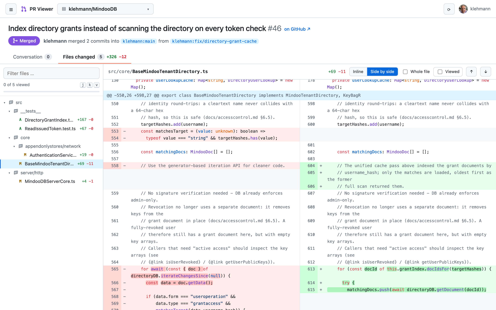
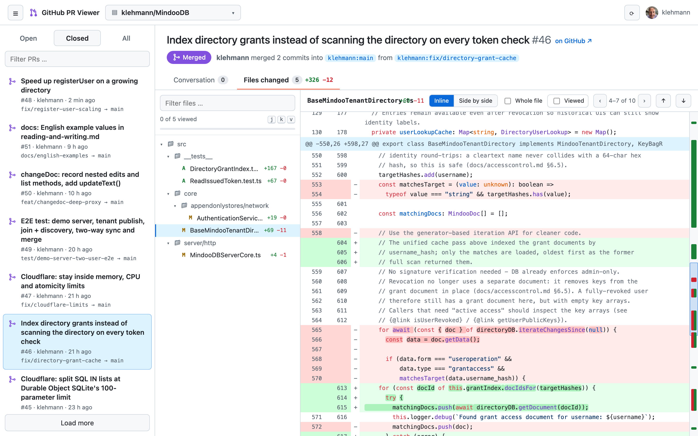
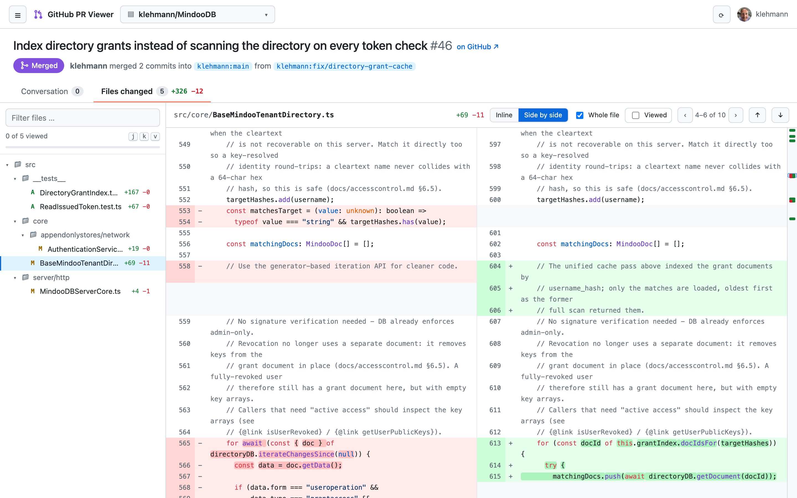
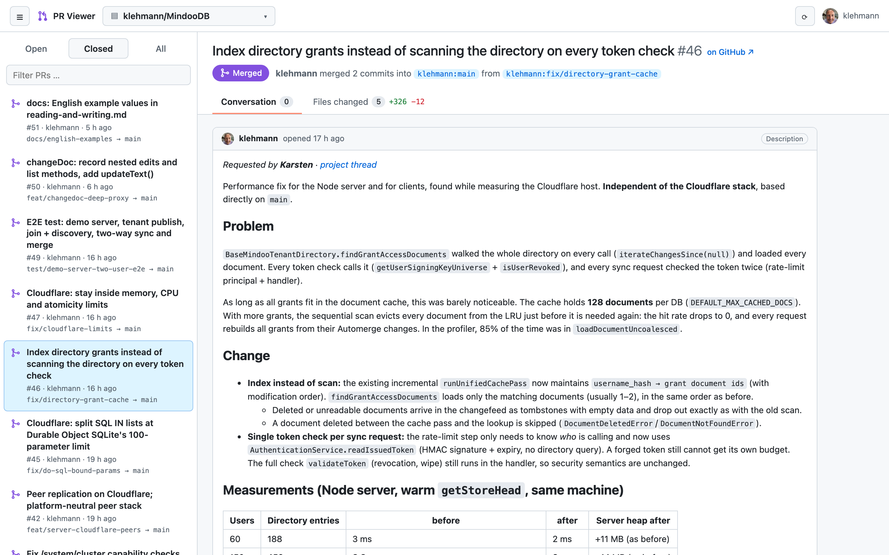

# GitHub PR Viewer

A small local web app for reviewing GitHub pull requests, as an alternative to the
"Files changed" view on github.com. Click a file on the left and the right side shows
only that one file, inline or side by side, optionally with the whole file content.



## Features

- Repository picker (your own, collaborator and organization repositories, filterable)
- Pull request list: open / closed / all, filter by title, number, branch or author
- Conversation: description, comments, reviews with code threads, checks and merge status
- Files changed: file tree on the left, exactly one file on the right
  - Inline or side-by-side diff with syntax highlighting and word-level highlights
  - "Whole file" shows the complete file with its changes (compared with the merge base)
  - A ruler next to the scrollbar marks every changed spot; click it to jump there, or step
    through the changes with `n` / `p`
  - Before/after preview for images, review comments shown at their line
  - "Viewed" checkbox per file (stored locally, reset when the file changes)
- Merge button (merge commit, squash or rebase) with a confirmation dialog
- Delete the head branch after merging (option in the merge dialog, or a button on merged and closed pull requests)
- Light and dark mode following the system setting

## Screenshots

The examples show a pull request from the public [MindooDB](https://github.com/klehmann/MindooDB) repository.

**Inline diff** – the file tree on the left, the selected file on the right:



**Side by side** – with the pull request list hidden (`l`) for more room:


**Whole file** – the complete file with its changes, compared with the merge base:



**Conversation** – description, comments, checks and the merge button:



## Getting started

Requirements: Node.js 18 or newer and the [GitHub CLI](https://cli.github.com/),
installed and signed in (`gh auth status`).

```bash
npm install
npm start
```

Then open http://localhost:4777. To use another port: `PORT=5000 npm start`.

## Keyboard shortcuts

| Key | Action |
| --- | --- |
| `j` / `k` | Next / previous file |
| `n` / `p` | Next / previous change in the current file |
| `v` | Mark the current file as viewed |
| `l` | Show / hide the pull request list |
| `r` | Reload |

## How it works

`server.js` is a dependency-free Node.js server. It reads your token with `gh auth token`
and forwards read requests to the GitHub REST API, so the token never reaches the browser.
The front end in `public/` is plain JavaScript and uses
[jsdiff](https://github.com/kpdecker/jsdiff) and [highlight.js](https://highlightjs.org/),
served from `node_modules`.

## Security

- The server listens on `127.0.0.1` only and accepts only the hosts `localhost` and
  `127.0.0.1`, which protects against DNS rebinding.
- Every API call needs a custom request header, so other websites cannot trigger calls.
- There are only two write operations, and the UI sends each one only after you confirm it:
  - the merge (`PUT /api/merge/:owner/:repo/:number`), which passes the head commit SHA,
    so GitHub refuses the merge if the branch changed in the meantime;
  - deleting a pull request's head branch (`DELETE /api/branch/:owner/:repo/:number`).
    The server looks up the branch name from the pull request itself and refuses open
    pull requests, branches in forks and the default branch.

## License

Copyright 2026 Mindoo GmbH

Licensed under the [Apache License, Version 2.0](LICENSE).
